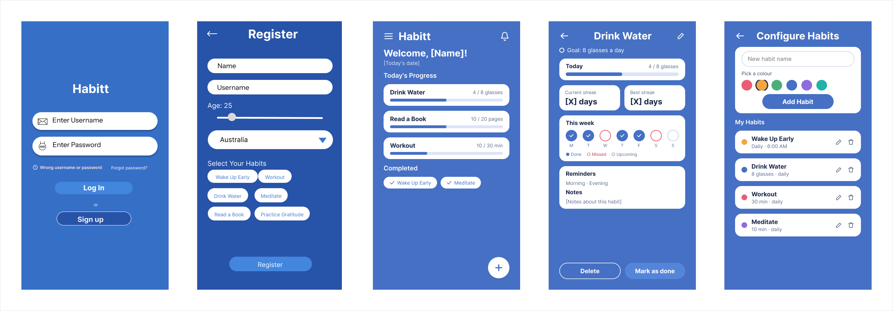
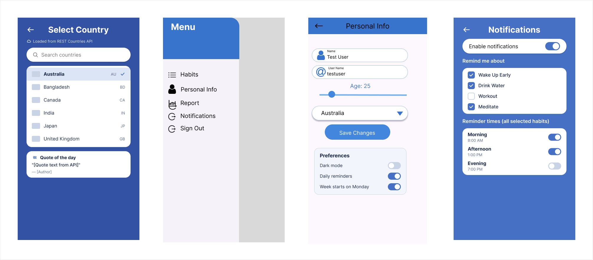

# Habitt – Habit Tracker

Habitt is a Flutter app that helps users build good habits and track their daily progress.

## Features

- **Login and registration**: users sign up with name, username, age and country, then log in.
- **Country list from an API**: the country dropdown on the Register screen is loaded from the [REST Countries API](https://restcountries.com).
- **Local storage**: user details and selected habits are saved on the device with `shared_preferences`.
- **Habit tracking**: users add habits, mark them done and see their daily progress.
- **Reports**: weekly view of completed and incomplete habits.
- **Notifications**: reminders for selected habits.

## Screens

| File | Screen |
| --- | --- |
| `login_screen.dart` | Log in with username and password |
| `register_screen.dart` | Create an account and choose habits |
| `habit_tracker_screen.dart` | Home screen with today's habits |
| `add_habit_screen.dart` | Add a new habit |
| `personal_info_screen.dart` | View and edit profile details |
| `reports_screen.dart` | Weekly progress report |
| `notifications_screen.dart` | Reminder settings |
| `country_list.dart` | Fetches the country list from the API |

## Project structure

```
habit_tracker/   (main branch)
├── lib/
├── pubspec.yaml
├── pubspec.lock
├── README.md
├── Uer_Stories.md
├── issue_templete.md
└── product_backlog.md
```

## Dependencies

- `shared_preferences` – saves user data locally
- `fluttertoast` – shows short pop-up messages
- `http` – calls the REST Countries API
- `flutter_local_notifications` – habit reminders

## How to run

1. Install [Flutter](https://docs.flutter.dev/get-started/install).
2. Clone this repository and open the project folder.
3. Install the packages:
   ```
   flutter pub get
   ```
4. Run the app in Chrome:
   ```
   flutter run -d chrome
   ```

**Test account:** username `testuser`, password `password123`

## Wireframes

The app screens were first designed as wireframes in Figma.



